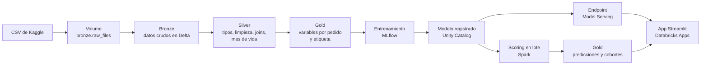
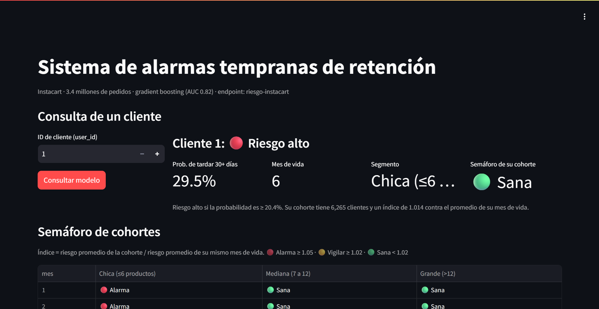
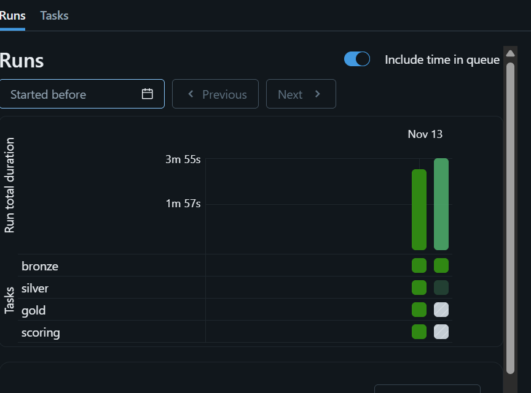

# Sistema de alarmas tempranas de retención por cohorte

Proyecto final del curso de Big Data, Especialidad en Ciencia de Datos, Universidad Panamericana.
Autor: Alvaro Dorado Quezada.

## El problema

En un negocio de compra recurrente, perder a un cliente rara vez es un evento puntual. Primero se espacian sus pedidos, después deja de comprar. Si el negocio detecta ese enfriamiento a tiempo, puede actuar con promociones, recordatorios o contacto directo antes de que el cliente se pierda.

Este proyecto construye un sistema que hace dos cosas:

1. Predice, para cada cliente y después de cada pedido, la probabilidad de que tarde 30 días o más en volver a comprar.
2. Agrupa esas predicciones por cohorte y prende un semáforo (Sana, Vigilar, Alarma) cuando una cohorte tiene más riesgo del normal para su etapa de vida.

## Datos

Se usa el dataset público [Instacart Market Basket Analysis](https://www.kaggle.com/competitions/instacart-market-basket-analysis) de Kaggle: pedidos de supermercado en línea de más de 200 mil clientes.

| Archivo | Registros |
|---|---:|
| orders.csv | 3,421,083 |
| order_products__prior.csv | 32,434,489 |
| order_products__train.csv | 1,384,617 |
| products.csv | 49,688 |
| aisles.csv | 134 |
| departments.csv | 21 |
| **Total** | **37,290,032** |

El dataset no trae fechas de calendario. Solo trae el número de pedido de cada cliente y los días transcurridos desde su pedido anterior, con tope en 30. Por eso las cohortes se definen por etapa de vida del cliente y no por mes de alta (ver la sección de cohortes).

## Arquitectura

Todo el proyecto corre en Databricks Free Edition con cómputo serverless.



| Componente | Herramienta |
|---|---|
| Almacenamiento | Delta Lake sobre Unity Catalog (catálogo `workspace`, esquemas `bronze`, `silver`, `gold`) |
| Procesamiento | PySpark, funciones de ventana |
| Orquestación | Databricks Jobs con ejecución semanal |
| Experimentos y registro de modelos | MLflow con Unity Catalog |
| Modelo publicado | Model Serving (endpoint `riesgo-instacart`) |
| Capa de resultados | Streamlit en Databricks Apps |

## Arquitectura Medallion

### Bronze

Los seis CSV se cargan tal cual llegan, todas las columnas como texto, con dos columnas de auditoría: `_ingest_ts` (hora de carga) y `_source_file` (archivo de origen). Notebook: `01_bronze`.

### Silver

Notebook: `02_silver`. Genera tres tablas:

- `silver.products`: productos unidos con su pasillo y departamento.
- `silver.orders`: pedidos con tipos corregidos, sin duplicados ni llaves nulas, y dos columnas nuevas. `dias_acumulados` suma los días entre pedidos de cada cliente con una función de ventana. `mes_vida` convierte esa antigüedad en meses (días 0 a 29 es el mes 1, 30 a 59 el mes 2, etc.).
- `silver.order_products`: une las tablas prior y train (33,819,106 líneas) y agrega cliente, número de pedido, pasillo y departamento.

Controles de calidad: 206,209 clientes únicos, el mismo número de primeros pedidos sin días previos (uno por cliente) y cero líneas sin departamento o sin cliente.

### Gold

Notebook: `03_gold`. Genera `gold.features_pedido` con un renglón por pedido de cada cliente (3,214,874 renglones).

**Etiqueta.** Para cada pedido se revisa el siguiente pedido del mismo cliente. Si llegó con 30 días o más de diferencia, la etiqueta es 1 (riesgo). La tasa de riesgo global es de 11.49%.

**Variables.** Solo usan información disponible hasta ese pedido, para evitar fuga de información:

| Variable | Descripción |
|---|---|
| order_number, mes_vida, dias_acumulados | Etapa de vida del cliente |
| order_dow, order_hour_of_day | Día y hora del pedido |
| days_since_prior_order | Días desde el pedido anterior |
| gap_promedio, gap_std, gap_max | Historial de días entre pedidos |
| n_gaps_30 | Veces que el cliente ya había tardado 30 días o más |
| basket_size, canasta_promedio, canasta_inicial | Tamaño de canasta actual, promedio y del primer pedido |
| n_departments | Departamentos distintos en el pedido |
| reorden_ratio_pedido, reorden_ratio_hist | Proporción de productos recomprados, en el pedido y acumulada |
| es_primer_pedido | Indicador del primer pedido |

La columna que mira al pedido siguiente se usa solo para construir la etiqueta y se elimina antes de guardar la tabla.

### Decisiones de limpieza y transformación

| Tema | Qué se hizo | Por qué |
|---|---|---|
| Tipos de dato | Bronze guarda todo como texto; Silver convierte cada columna a entero o decimal. | Bronze conserva el dato original sin riesgo de perder valores al leer. La conversión se hace una sola vez, en un lugar controlado. |
| Duplicados | `dropDuplicates` por `order_id` en pedidos, por `product_id` en productos y por `(order_id, product_id)` en el detalle. | Cada llave debe aparecer una sola vez; un duplicado contaría dos veces el mismo pedido o producto. |
| Nulos en llaves | Se eliminan pedidos sin `order_id` o sin `user_id`. | Sin llave no se puede saber a qué cliente pertenece el pedido. |
| Nulos esperados | El primer pedido de cada cliente no tiene días previos, y la desviación estándar no existe con menos de dos intervalos. Se rellenan con 0 y se agrega la variable `es_primer_pedido`. | No son errores sino casos donde el valor no existe. El indicador le avisa al modelo que el 0 tiene ese significado. |
| Valores extremos | No se eliminaron. Los días entre pedidos ya vienen con tope en 30 desde la fuente, y el mes de vida se agrupa en "7 o más". | Las canastas muy grandes o los clientes muy antiguos son comportamientos reales, no errores de captura. El gradient boosting divide por rangos y no se distorsiona con valores extremos. |
| Normalización | `StandardScaler` dentro del pipeline de la regresión logística. El gradient boosting no la necesita. | La regresión logística es sensible a la escala de las variables; los árboles no. |
| Codificación | No se requirió codificación categórica: todas las variables del modelo son numéricas. El segmento de canasta (texto) solo se usa para agrupar cohortes; al modelo entra la versión numérica, `canasta_inicial`. | Evita crear columnas de más y mantiene la misma información. |

## Cohortes

Una cohorte es la combinación de dos dimensiones:

- **Mes de vida**, agrupado del 1 al 6 más un grupo de 7 o más.
- **Segmento de canasta inicial**, según el número de productos del primer pedido. Los cortes se calcularon con terciles: chica (6 o menos), mediana (7 a 12) y grande (más de 12).

| Segmento | Clientes | Tasa de riesgo |
|---|---:|---:|
| Chica | 78,009 | 12.52% |
| Mediana | 67,754 | 11.18% |
| Grande | 60,446 | 10.66% |

Los clientes que empiezan con una canasta chica tienen más riesgo de enfriarse.

El mes de vida por sí solo no basta para definir cohortes. Sin fechas, cada etapa tendría un solo grupo y no habría con quién compararlo. El segmento permite comparar varios grupos dentro de la misma etapa.

## Modelo

Notebook: `04_modelo`.

- **Muestra.** Se entrena con el 40% de los clientes (1,287,729 renglones), elegidos por hash del `user_id`. Spark procesa los 37 millones de registros; la muestra se usa solo para entrenar en memoria con scikit-learn.
- **Separación.** 80% entrenamiento y 20% prueba, por cliente (`GroupShuffleSplit`). Ningún cliente aparece en los dos conjuntos.
- **Tipo de tarea.** Clasificación binaria: 1 si el cliente tarda 30 días o más en volver, 0 si vuelve antes.
- **Métricas.** Las clases están desbalanceadas (solo el 11.5% de los casos son positivos), así que la exactitud no sirve: un modelo que siempre dijera "no hay riesgo" acertaría el 88.5%. La **métrica principal es AUC-PR**, que se enfoca en la clase minoritaria. El umbral de decisión se eligió maximizando **F1**, para equilibrar precisión y recall. AUC-ROC se reporta como complemento.

| Modelo | AUC-ROC | AUC-PR | Umbral F1 | Precisión | Recall |
|---|---:|---:|---:|---:|---:|
| Gradient boosting (HistGradientBoosting) | **0.8184** | **0.3450** | 0.2038 | 30.1% | 63.1% |
| Regresión logística | 0.8130 | 0.3311 | 0.1810 | 29.6% | 64.2% |

El AUC-PR del modelo ganador es tres veces el de un modelo al azar (0.115). Con el umbral de 0.2038, el sistema detecta 63 de cada 100 casos en que el cliente se enfrió, y 30 de cada 100 alertas son correctas. Para una alarma temprana es un balance razonable: es preferible avisar de más que dejar pasar casos.

El modelo ganador se registró en Unity Catalog como `workspace.gold.modelo_riesgo` con el alias `champion`.

## Scoring y validación

Notebook: `05_scoring`. Carga el modelo registrado como función de Spark y califica los 3,214,874 renglones de Gold.

| Validación | Resultado |
|---|---|
| Probabilidad promedio vs. tasa real | 11.51% vs. 11.49% (modelo calibrado) |
| % marcado como riesgo alto | 24.07% |
| AUC-ROC en clientes que el modelo nunca vio (1,927,145 renglones) | **0.8211** |

El AUC fuera de muestra es igual o mejor que el de la prueba, así que el modelo generaliza.

## Semáforo de cohortes

Para el estado actual se toma el último pedido de cada cliente. Cada cohorte se compara contra el promedio de su mismo mes de vida:

> índice = riesgo promedio de la cohorte / riesgo promedio de su mes de vida

| Índice | Semáforo |
|---|---|
| ≥ 1.05 | Alarma |
| ≥ 1.02 | Vigilar |
| < 1.02 | Sana |

Los umbrales se fijaron con los datos: dentro de un mismo mes los segmentos se separan entre 5% y 6%, así que un umbral más alto nunca prendería una alarma. Para validarlos se calculó el mismo índice con la tasa real de cada cohorte.

Extracto de la tabla `gold.cohortes`:

| Mes | Segmento | Clientes | Riesgo predicho | Riesgo real | Índice | Semáforo |
|---|---|---:|---:|---:|---:|---|
| 1 | Chica | 4,571 | 0.099 | 0.250 | 1.058 | Alarma |
| 1 | Mediana | 3,993 | 0.093 | 0.228 | 0.987 | Sana |
| 1 | Grande | 3,298 | 0.088 | 0.196 | 0.935 | Sana |
| 2 | Chica | 11,387 | 0.235 | 0.397 | 1.059 | Alarma |
| 2 | Mediana | 9,447 | 0.216 | 0.370 | 0.972 | Sana |
| 2 | Grande | 7,994 | 0.211 | 0.354 | 0.949 | Sana |
| 3 | Chica | 12,744 | 0.298 | 0.443 | 1.057 | Alarma |
| 3 | Mediana | 9,994 | 0.273 | 0.424 | 0.968 | Sana |
| 3 | Grande | 8,203 | 0.268 | 0.417 | 0.951 | Sana |

En los meses 1 a 3 el modelo y la realidad coinciden en el orden: la canasta chica tiene más riesgo, luego la mediana y al final la grande. El sistema prende la alarma justo en las cohortes que después tuvieron más clientes que se enfriaron.

## Modelo publicado y capa de resultados

El modelo se publicó como endpoint de Model Serving (`riesgo-instacart`, CPU, scale to zero). Para comprobar que responde igual que el modelo usado en lote, se consultó el último pedido del cliente 1:

```
Respuesta del endpoint: [[0.7051, 0.2949]]
Probabilidad (endpoint): 0.2949
Probabilidad (lote):     0.2949
```

### API del modelo

La especificación completa está en `openapi.yaml` (OpenAPI 3.0).

- **Método y ruta:** `POST https://<host-del-workspace>/serving-endpoints/riesgo-instacart/invocations`
- **Autenticación:** `Authorization: Bearer <token de Databricks>`
- **Validación de entradas:** el modelo se registró con firma de MLflow (17 columnas numéricas). El endpoint rechaza una petición si falta una columna o si un valor no es numérico.

Petición:

```json
{
  "dataframe_records": [{
    "order_number": 10, "mes_vida": 6, "order_dow": 4, "order_hour_of_day": 8,
    "dias_acumulados": 176, "days_since_prior_order": 30, "gap_promedio": 19.6,
    "gap_std": 9.2, "gap_max": 30, "n_gaps_30": 2, "basket_size": 9,
    "canasta_promedio": 5.9, "n_departments": 4, "reorden_ratio_pedido": 0.67,
    "reorden_ratio_hist": 0.69, "es_primer_pedido": 0, "canasta_inicial": 5
  }]
}
```

Respuesta (probabilidad de "no riesgo" y de "riesgo"):

```json
{ "predictions": [[0.7051, 0.2949]] }
```

Los valores de la petición son ilustrativos del formato.

### App

La capa de resultados es una app de Streamlit en Databricks Apps, en una sola pantalla:

- **Consulta de un cliente.** Se escribe un `user_id`, la app busca las variables de su último pedido en `gold.features_pedido`, las envía al endpoint y muestra la probabilidad, la clasificación (riesgo alto o bajo) y el semáforo de su cohorte.
- **Semáforo de cohortes.** Tabla con las 21 cohortes (7 meses de vida por 3 segmentos).

La app consume el endpoint publicado; no tiene una copia local del modelo. Manejo de errores:

- **Entradas:** el campo solo acepta enteros del 1 al 206,209, y la consulta a la base va parametrizada.
- **Tiempo de espera:** si el endpoint no responde en 20 segundos, la app deja de esperar.
- **Respuestas inválidas:** se revisa que la respuesta traiga dos probabilidades y que estén entre 0 y 1.
- **Respaldo:** ante cualquiera de esos fallos, la app muestra la probabilidad del cálculo en lote (el mismo modelo, ya calculada en `gold.clientes_estado_actual`) y dice en pantalla por qué no usó el endpoint.



Un ejemplo útil: el cliente 1 tiene riesgo alto (29.5%) pero pertenece a una cohorte Sana (mes 6, canasta chica, índice 1.014). Las dos lecturas se complementan: el semáforo dice dónde mirar a nivel grupo, y la consulta individual detecta clientes en riesgo aunque su grupo esté bien.

## Orquestación

El Job `pipeline_alarmas_retencion` corre las cuatro etapas en cadena, y cada tarea empieza solo si la anterior terminó bien:

```
bronze → silver → gold → scoring
```

La corrida completa tarda menos de 4 minutos y está programada cada semana. El entrenamiento (`04_modelo`) queda fuera del Job a propósito: reentrenar en cada corrida registraría una versión nueva del modelo cada vez. Se entrena de forma puntual y se califica seguido con el modelo vigente.



## Limitaciones

**Días entre pedidos con tope en 30.** Instacart reporta 30 cuando pasaron 30 días o más, así que la antigüedad de los clientes que tardan más queda subestimada.

**Comportamiento distinto en el último pedido.** El pedido que sigue al último pedido histórico de cada cliente es el pedido de evaluación que armó Instacart, y llega con 30 días o más mucho más seguido:

| | Renglones | Tasa real | Probabilidad del modelo |
|---|---:|---:|---:|
| Pedidos normales | 3,008,665 | 10.18% | 11.06% |
| Último pedido | 206,209 | 30.64% | 18.00% |

En los pedidos normales el modelo está calibrado. En el último pedido subestima el nivel de riesgo, pero el orden entre segmentos se mantiene, y el semáforo depende de ese orden y no del nivel absoluto.

**Sin fechas de calendario.** No se pueden armar cohortes por mes de alta ni medir estacionalidad.

**Terciles con empates.** Muchos clientes tienen exactamente 6 o 12 productos en su primer pedido, así que los segmentos no quedan en tercios exactos.

## Cómo reproducirlo

1. Crear una cuenta en Databricks Free Edition.
2. Descargar el dataset de Kaggle y descomprimir los seis CSV.
3. En el SQL Editor, crear los esquemas y el volume:

   ```sql
   CREATE SCHEMA IF NOT EXISTS workspace.bronze;
   CREATE SCHEMA IF NOT EXISTS workspace.silver;
   CREATE SCHEMA IF NOT EXISTS workspace.gold;
   CREATE VOLUME IF NOT EXISTS workspace.bronze.raw_files;
   ```

4. Subir los CSV a `workspace.bronze.raw_files`.
5. Importar los notebooks y correrlos en orden: `01_bronze`, `02_silver`, `03_gold`, `04_modelo`, `05_scoring`.
6. Crear el endpoint `riesgo-instacart` con el modelo `workspace.gold.modelo_riesgo`.
7. Crear la app en Databricks Apps con los recursos `sql-warehouse` (SQL warehouse, Can use) y `serving-endpoint` (endpoint, Can query), dar al service principal de la app `USE CATALOG` sobre `workspace` y `USE SCHEMA` y `SELECT` sobre `workspace.gold`, y desplegar una carpeta con `app.py`, `app.yaml` y `requirements.txt`.
8. Crear el Job con las tareas `bronze → silver → gold → scoring`.

## Estructura del repositorio

| Archivo | Contenido |
|---|---|
| `README.md` | Esta documentación |
| `01_bronze.py` a `05_scoring.py` | Notebooks de Databricks exportados como código fuente |
| `app.py`, `app.yaml`, `requirements.txt` | App de Streamlit para Databricks Apps |
| `openapi.yaml` | Documentación de la API del modelo publicado |
| `app.png`, `job.png` | Capturas de la app y del Job |
